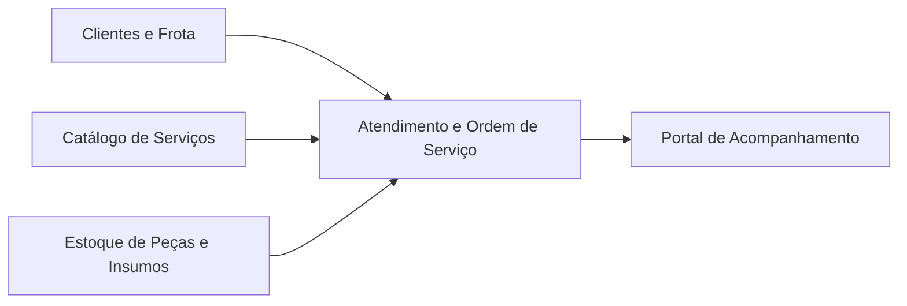
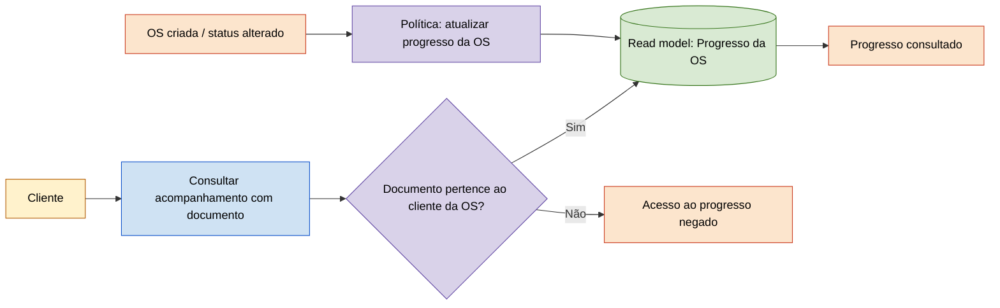
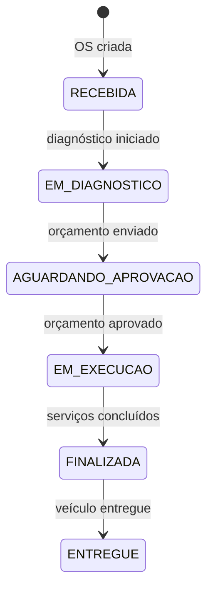

# Event Storming — Oficina API SOAP Challenger 1

## Objetivo e convenções

Este Event Storming representa os fluxos de negócio do MVP, usando a Linguagem Ubíqua da oficina. Os diagramas seguem a convenção de cores normalmente usada em DDD/Event Storming:

| Cor | Elemento | Exemplos |
|---|---|---|
| Amarelo | Ator | Cliente, Atendente, Mecânico, Almoxarife |
| Azul | Comando | Criar OS, Aprovar orçamento, Registrar entrada |
| Laranja | Evento de domínio | OS criada, Orçamento aprovado, Estoque baixado |
| Roxo | Política/Reação | Quando orçamento é aprovado, liberar execução |
| Rosa | Agregado | Ordem de Serviço, Item de Estoque |
| Verde | Consulta/Read model | Acompanhamento do cliente, saldo disponível |
| Vermelho | Hotspot/regra a decidir | Reserva e baixa de estoque |

## Contextos delimitados (Bounded Contexts)

| Contexto | Responsabilidade | Agregado principal |
|---|---|---|
| Clientes e Frota | Manter os dados de clientes e veículos | Cliente, Veículo |
| Atendimento e Ordem de Serviço | Orçar, aprovar, executar e entregar o serviço | Ordem de Serviço |
| Catálogo de Serviços | Definir preço e duração estimada de serviços | Serviço |
| Estoque de Peças e Insumos | Controlar saldo, entradas, reservas e baixas | Item de Estoque |
| Portal de Acompanhamento | Expor a situação da OS ao cliente | Progresso da OS (read model) |

---

# Fluxo 1 — Criação e acompanhamento da Ordem de Serviço

## Linha do tempo de negócio

```mermaid
flowchart LR
    classDef actor fill:#FFF2CC,stroke:#B45F06,color:#000;
    classDef command fill:#CFE2F3,stroke:#1155CC,color:#000;
    classDef event fill:#FCE5CD,stroke:#CC4125,color:#000;
    classDef policy fill:#D9D2E9,stroke:#674EA7,color:#000;
    classDef aggregate fill:#F4CCCC,stroke:#990000,color:#000;
    classDef readmodel fill:#D9EAD3,stroke:#38761D,color:#000;

    cliente[Cliente]:::actor --> c1[Solicitar atendimento]:::command
    c1 --> e1[Atendimento solicitado]:::event
    atendente[Atendente]:::actor --> c2[Identificar cliente por CPF/CNPJ]:::command
    c2 --> e2[Cliente identificado]:::event
    e2 --> p1{Cliente existe?}:::policy
    p1 -->|Não| c3[Cadastrar cliente]:::command
    c3 --> e3[Cliente cadastrado]:::event
    p1 -->|Sim| c4[Identificar veículo pela placa]:::command
    e3 --> c4
    c4 --> e4[Veículo identificado]:::event
    e4 --> p2{Veículo existe?}:::policy
    p2 -->|Não| c5[Cadastrar veículo]:::command
    c5 --> e5[Veículo cadastrado]:::event
    p2 -->|Sim| c6[Criar ordem de serviço]:::command
    e5 --> c6
    c6 --> os[(Agregado: Ordem de Serviço)]:::aggregate
    os --> e6[OS criada<br/>Status: RECEBIDA]:::event
    mecanico[Mecânico]:::actor --> c7[Registrar diagnóstico]:::command
    e6 --> c7
    c7 --> e7[Diagnóstico registrado]:::event
    mecanico --> c8[Incluir serviço solicitado]:::command
    e7 --> c8
    c8 --> e8[Serviço incluído na OS]:::event
    mecanico --> c9[Incluir peça ou insumo necessário]:::command
    e8 --> c9
    c9 --> e9[Peça ou insumo incluído na OS]:::event
    e9 --> p3[Política: recalcular orçamento]:::policy
    p3 --> e10[Orçamento gerado]:::event
    atendente --> c10[Enviar orçamento ao cliente]:::command
    e10 --> c10
    c10 --> e11[Orçamento enviado<br/>Status: AGUARDANDO_APROVACAO]:::event
    cliente --> c11[Aprovar orçamento]:::command
    e11 --> c11
    c11 --> e12[Orçamento aprovado]:::event
    e12 --> p4[Política: liberar execução]:::policy
    p4 --> e13[OS em execução<br/>Status: EM_EXECUCAO]:::event
    mecanico --> c12[Finalizar serviços]:::command
    e13 --> c12
    c12 --> e14[OS finalizada<br/>Status: FINALIZADA]:::event
    atendente --> c13[Entregar veículo]:::command
    e14 --> c13
    c13 --> e15[Veículo entregue<br/>Status: ENTREGUE]:::event
```

## Acompanhamento pelo cliente

## Regras e políticas da OS

| Evento de domínio | Política | Resultado esperado |
|---|---|---|
| `OS criada` | Atribuir status inicial | `RECEBIDA` |
| `Diagnóstico registrado` | Preparar orçamento | Serviços e itens podem ser incluídos |
| `Orçamento enviado` | Aguardar decisão do cliente | `AGUARDANDO_APROVACAO` |
| `Orçamento aprovado` | Liberar execução | `EM_EXECUCAO` |
| `OS em execução` | Registrar hora de início | Base para tempo médio de execução |
| `OS finalizada` | Registrar hora de término | Base para tempo médio de execução |
| `Veículo entregue` | Encerrar atendimento | `ENTREGUE` e histórico preservado |

---

# Fluxo 2 — Gestão de peças e insumos

## Linha do tempo de negócio

```mermaid
flowchart LR
    classDef actor fill:#FFF2CC,stroke:#B45F06,color:#000;
    classDef command fill:#CFE2F3,stroke:#1155CC,color:#000;
    classDef event fill:#FCE5CD,stroke:#CC4125,color:#000;
    classDef policy fill:#D9D2E9,stroke:#674EA7,color:#000;
    classDef aggregate fill:#F4CCCC,stroke:#990000,color:#000;
    classDef readmodel fill:#D9EAD3,stroke:#38761D,color:#000;
    classDef hotspot fill:#F4CCCC,stroke:#CC0000,stroke-width:3px,color:#000;

    almoxarife[Almoxarife / Administrador]:::actor --> c1[Cadastrar item de estoque]:::command
    c1 --> estoque[(Agregado: Item de Estoque)]:::aggregate
    estoque --> e1[Item de estoque cadastrado]:::event
    almoxarife --> c2[Registrar entrada de item]:::command
    e1 --> c2
    c2 --> e2[Estoque reposto]:::event
    e2 --> saldo[(Read model: Saldo disponível)]:::readmodel

    mecanico[Mecânico]:::actor --> c3[Informar peça necessária na OS]:::command
    c3 --> e3[Peça solicitada para a OS]:::event
    e3 --> p1[Política: verificar saldo]:::policy
    saldo --> p1
    p1 --> d1{Saldo suficiente?}:::policy
    d1 -->|Não| e4[Estoque insuficiente]:::event
    e4 --> c4[Solicitar reposição ou revisar orçamento]:::command
    c4 --> e5[Reposição solicitada]:::event
    d1 -->|Sim| c5[Reservar peça para a OS]:::command
    c5 --> e6[Peça reservada]:::event
    e6 --> p2[Política: incluir item no orçamento]:::policy
    p2 --> e7[Peça orçada]:::event

    e7 --> c6[Confirmar uso da peça]:::command
    c6 --> e8[Estoque baixado]:::event
    e8 --> saldo
    e8 --> e9[Peça consumida pela OS]:::event

    h1[Hotspot: definir se a baixa ocorre<br/>na criação, aprovação ou execução da OS]:::hotspot
    e6 -. decisão de negócio .-> h1
    e8 -. decisão de negócio .-> h1
```

## Regras de estoque

| Regra | Significado na Linguagem Ubíqua |
|---|---|
| Saldo não pode ficar negativo | Uma peça ou insumo só pode ser consumido quando há quantidade disponível. |
| Reserva protege a disponibilidade | Uma peça reservada para uma OS deixa de estar disponível para outras OS. |
| Baixa registra consumo | A baixa reduz o saldo quando a peça é efetivamente usada. |
| Reposição aumenta saldo | A entrada de compra/devolução atualiza o item de estoque. |
| Peça orçada não é necessariamente consumida | O orçamento pode ser recusado antes da execução. |

> **Hotspot do MVP atual:** a API baixa o estoque quando a OS é criada. Para a regra de negócio mais segura, o comportamento deve evoluir para reservar a peça ao gerar/enviar o orçamento e efetivar a baixa apenas após a aprovação ou durante a execução.

---

# Linguagem Ubíqua

| Termo | Definição compartilhada |
|---|---|
| Cliente | Pessoa física ou jurídica identificada por CPF ou CNPJ que solicita atendimento. |
| Veículo | Automóvel pertencente a um cliente, identificado principalmente pela placa. |
| Ordem de Serviço (OS) | Registro que reúne o atendimento, diagnóstico, orçamento, execução e entrega de um veículo. |
| Diagnóstico | Avaliação técnica que identifica os serviços e itens necessários para a OS. |
| Serviço | Trabalho de manutenção com preço e tempo estimado. |
| Peça | Item físico utilizado no reparo e controlado em estoque. |
| Insumo | Material de consumo utilizado no serviço, também controlado em estoque. |
| Orçamento | Valor calculado a partir dos serviços e das peças/insumos incluídos na OS. |
| Aprovação | Autorização do cliente para iniciar a execução do orçamento. |
| Reserva de estoque | Separação temporária de uma peça para uma OS aprovada ou em avaliação. |
| Baixa de estoque | Redução definitiva do saldo após o consumo da peça/insumo. |
| Progresso da OS | Visão consultável pelo cliente com status e valor da sua OS. |

# Estados da Ordem de Serviço

## Invariantes do domínio

1. Uma OS sempre pertence a exatamente um cliente e um veículo desse cliente.
2. Uma OS só entra em execução após a aprovação do orçamento.
3. O status da OS não pode retroceder nem pular etapas.
4. A consulta pública de uma OS exige documento correspondente ao cliente proprietário.
5. Nenhuma peça ou insumo pode deixar o estoque com saldo negativo.
6. O valor total da OS é a soma dos serviços e dos itens incluídos.
